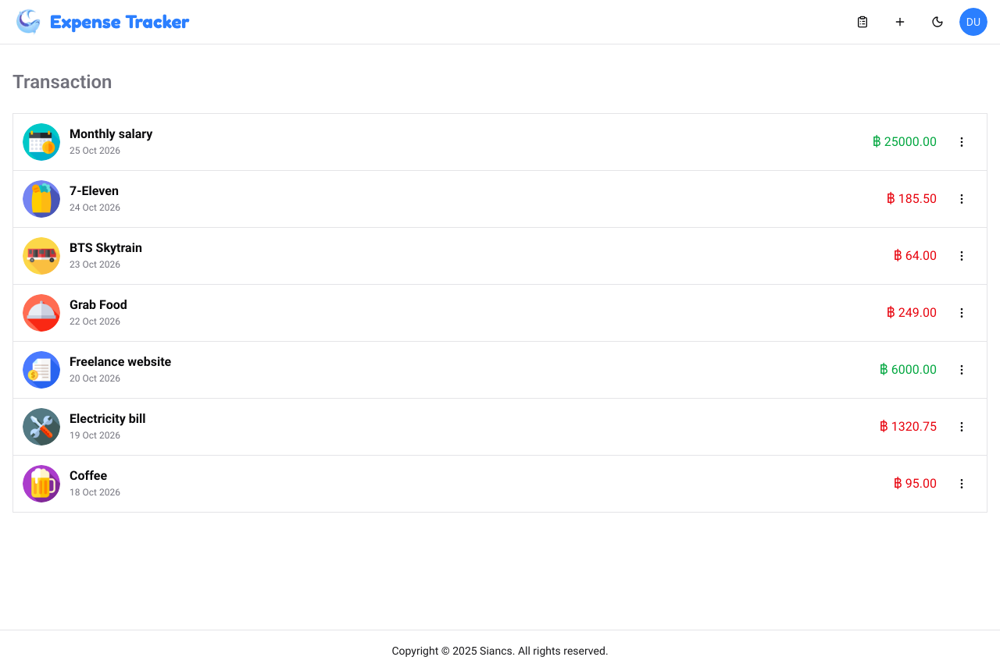
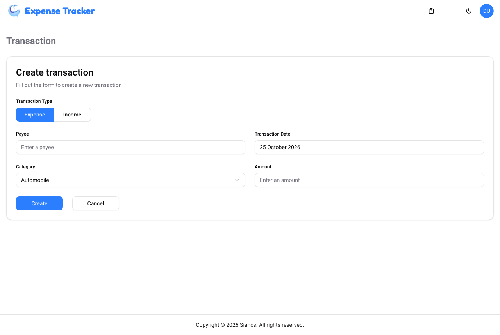
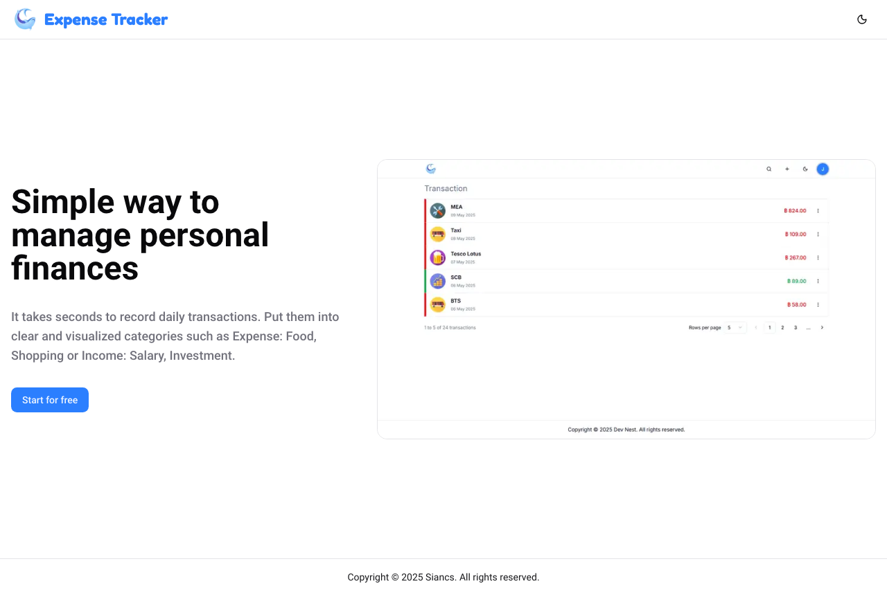

# Expense Tracker

A full-stack personal finance app built with the Next.js App Router. Record income and expenses by category, then edit, duplicate or delete them — all through Server Actions, with every query scoped to the signed-in user.

**Live demo:** https://nextjs-crud-gold-gamma.vercel.app (sign up with any email — it's a demo database)



<details>
<summary>More screenshots</summary>




</details>

## Features

- **Auth** — sign up / sign in with email and password (Auth.js credentials provider, bcrypt-hashed passwords, JWT sessions)
- **Transactions** — create, edit, duplicate and delete income/expense entries with payee, date, amount and category
- **Route protection** — middleware redirects guests away from `/transaction/*` and signed-in users away from the auth pages
- **Validation on both sides** — the same Zod schemas drive React Hook Form on the client and Server Actions on the server
- **Dark mode** via `next-themes`

## Security notes

Server Actions are public HTTP endpoints — anyone can `POST` to them, not just the UI. So every action re-checks on the server:

- the user has a valid session,
- the transaction belongs to that user (`where: { id, userId }` on update/delete, so another user's ID simply matches nothing),
- the chosen category matches the transaction type (an "income" can't use an "expense" category).

## Tech Stack

| Area | Tools |
|---|---|
| Framework | Next.js 15 (App Router, Server Actions, Turbopack), React 19, TypeScript |
| Auth | Auth.js v5 (NextAuth) |
| Database | PostgreSQL (Neon) + Prisma ORM |
| Forms & validation | React Hook Form + Zod |
| UI | Tailwind CSS 4, shadcn/ui (Radix), lucide-react, sonner |

## Getting Started

Requires Node.js 20+, [pnpm](https://pnpm.io) and a PostgreSQL database (e.g. a free [Neon](https://neon.tech) project).

```bash
pnpm install                 # also runs `prisma generate`
cp .env.example .env         # fill in DATABASE_URL and AUTH_SECRET
pnpm prisma migrate deploy   # create tables
pnpm db:seed                 # insert income/expense categories
pnpm dev                     # http://localhost:3000
```

| Variable | Description |
|---|---|
| `DATABASE_URL` | PostgreSQL connection string |
| `AUTH_SECRET` | Secret for signing session tokens — generate with `npx auth secret` |
| `AUTH_TRUST_HOST` | Set to `true` when running `next start` outside Vercel (Vercel is detected automatically) |
| `NEXT_PUBLIC_APP_NAME` / `NEXT_PUBLIC_APP_DESCRIPTION` | Optional branding (defaults to "Expense Tracker") |

## Project Structure

```
src/
├── app/
│   ├── (auth)/           # /signin, /signup
│   └── (transaction)/    # /transaction, create, [id]/edit, [id]/create (duplicate)
├── components/           # auth forms, transaction list/form, layout, shadcn/ui
├── lib/
│   ├── actions/          # Server Actions (auth, transactions)
│   ├── datas/            # Server-side data fetching
│   ├── schemas/          # Zod schemas shared by client and server
│   ├── services/         # Sign-up logic
│   └── auth/             # Auth.js configuration
└── middleware.ts         # Route protection
prisma/
├── schema.prisma
└── migrations/
```
